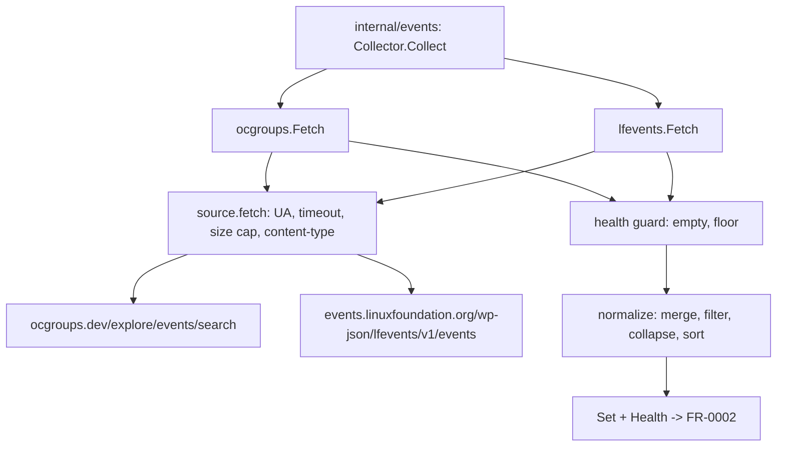

# Technical spec: FR-0001 · Event ingestion and normalization

**Complexity:** medium

## 1. Technical summary

**What.** A new `internal/events` package that fetches two public event listings over HTTP, decodes them into one
common event shape, filters and collapses the result, and reports the health of each source for the run. It exposes a
single entry point — a `Collector` whose `Collect` returns the normalized event set plus a per-source health report —
and it knows nothing about Discord.

**Why.** The two upstreams disagree about almost everything: one publishes exact instants with an IANA time zone and a
UUID identifier, the other publishes floating calendar dates with a WordPress integer identifier and no clock time at
all. One is a stable, documented, purpose-built route that its own `llms.txt` advertises for machine consumption; the
other is an undocumented internal handler on a service that deploys from `main` the same day. Merging them at the edge,
behind one shape, keeps that mess out of the announcement logic (FR-0002) and gives the failure modes a single place to
be caught. The package sits below `internal/bot` and beside `internal/discord`, importing neither, so the repository's
`bot → discord → websocket` layering gains a parallel leaf rather than a new tier.

**Why the guards are part of ingestion, not of publishing.** The dangerous failure of this feature is not an exception;
it is a silent success. The community-group upstream ignores unknown query parameters rather than rejecting them, so a
renamed filter slug returns `HTTP 200` with `total: 0` and decodes cleanly. Every other failure — a 404, a 422, an HTML
sibling route, a DNS failure — is loud. Only the empty-but-successful response looks exactly like a quiet day. Treating
zero records as a source failure, and a sudden collapse in record count as a suspect source, is therefore a correctness
requirement of ingestion rather than an operational nicety, and it belongs where the record count is known.

**Scope**

- **Included:** the community-group source client; the flagship conference source client; shared request discipline
  (identifying User-Agent, timeout, size ceiling, content-type assertion); merge, filter, series collapsing, sorting
  and text sanitization; the per-source health guards; the typed source errors.
- **Deferred to FR-0002:** the scheduler, delta detection, message composition and publishing, the run outcome log
  line, Discord markdown escaping, and the announcement channel configuration.
- **Deferred outside this PRD:** the Kubernetes Community Days listing on `cncf.io` (PRD §9), and any persistent cache
  of fetched results.

**Requirements / business rules** (from the PRD's FR-0001 Capabilities block)

| Rule | Value |
| ---- | ----- |
| Active window | run day − 1 day … run day + 6 months + 1 day |
| Fetches per source per run | exactly 1 |
| Page size (community source) | 100, the upstream hard cap; 101 or more returns HTTP 422 |
| Page ceiling (community source) | 10 pages, then stop |
| Response size ceiling | 8 MB, both sources |
| Title truncation | 120 characters, at a word boundary, with a visible ellipsis |
| Zero-record response | a source failure, never an empty result |
| Degraded threshold | below 30% of that source's last successful record count |
| Filtered out | canceled, test, not published, start already in the past |
| Series collapsing | one surviving occurrence per series — the earliest future one |

**UX flows.** None directly. The package is consumed by FR-0002 and has no Discord surface, no command, and nothing a
member waits on. Its member-visible effect is negative space, as the PRD's Experience block describes: the recurring
working group call appears once instead of seven times, a canceled meetup never appears, and a broken upstream produces
silence rather than a confident "no upcoming events".

**Applicable NFRs**

| NFR | How this spec meets it |
| --- | ---------------------- |
| NFR-0001 No third-party dependencies | `net/http`, `encoding/json`, `time`, `strings`, `unicode`, `sort`, `context`, `log/slog` only. `go.mod` stays dependency-free. |
| NFR-0002 No persistent storage | The only state is the guard's last-good record counts, held on the `Collector` value. Nothing is written to disk. |
| NFR-0003 No new platform privileges | The package makes no Discord call at all and cannot import `internal/discord`. |
| NFR-0004 Identified outbound requests | A single `fetch` helper sets the User-Agent on every request; a test asserts it is set and is not the runtime default. |
| NFR-0005 Polite polling | `Collect` performs exactly one request per source, plus at most 9 further pages for the community source. |
| NFR-0006 Log hygiene | The package logs counts, statuses and durations. Titles, payloads and URLs beyond the host are never logged. |
| NFR-0009 Bounded I/O | Every request carries a context deadline; every body is read through an 8 MB limit reader and stream-decoded. |
| NFR-0010 Attribution | Every event carries the canonical upstream page address, built and verified per source. |
| NFR-0012 Upstream drift detection | A build-tagged contract test exercises the live endpoints; it is excluded from `make test` and run on a schedule in CI. |
| NFR-0013 Deterministic tests | Every test runs against an `httptest.Server` with captured payload shapes and an injected clock. No test reaches the network. |

**Assumptions / decisions**

| Assumption | Origin |
| ---------- | ------ |
| The two sources are fetched sequentially rather than concurrently. | Auto-Accept: two requests a day do not justify a goroutine, and the repository's concurrency rule makes every goroutine a design commitment. |
| Base URLs are functional options rather than environment variables. | Auto-Accept, with the trade-off recorded in §3 — the community-group host is mid-migration, so this is revisited if it moves. |
| Discord markdown escaping happens at render time in FR-0002, not here. | Codebase pattern: `internal/events` must not know its consumer's markup. FR-0001 performs the source-agnostic half of AC-0005.02. |
| The event's local calendar day is computed with `time.LoadLocation`, with UTC as the documented fallback. | PRD FR-0001 Capabilities ("computed from the event's own published time zone"). Requires the tzdata import in §3. |
| A "past" event is one whose start is before the moment the run began, not before the moment the record is examined. | Auto-Accept: a single run must produce one consistent view; the clock is captured once per `Collect`. |

## 2. Architecture impact

**New files**

- `internal/events/events.go`
- `internal/events/source.go`
- `internal/events/ocgroups.go`
- `internal/events/lfevents.go`
- `internal/events/normalize.go`
- `internal/events/collector.go`
- `internal/events/events_test.go`
- `internal/events/source_test.go`
- `internal/events/ocgroups_test.go`
- `internal/events/lfevents_test.go`
- `internal/events/normalize_test.go`
- `internal/events/collector_test.go`
- `internal/events/contract_test.go` (build tag `contract`, excluded from `make test`)
- `.github/workflows/contract.yml`

**Modified files**

- `cmd/bot/main.go` — the blank `time/tzdata` import.



## 3. Technical decisions

| Decision | Chosen approach | Alternative considered | Trade-off | Origin |
| -------- | --------------- | ---------------------- | --------- | ------ |
| Package placement | A new leaf `internal/events`, importing neither `discord` nor `websocket` | Extending `internal/discord` with the sources | A fourth top-level package to document, in exchange for a package that is testable without any Discord type and cannot accidentally acquire one | Codebase pattern (CLAUDE.md layering rule) |
| Time zone data | Blank-import `time/tzdata` in `cmd/bot/main.go` | Rely on the base image's `/usr/share/zoneinfo` | ~450 KB of binary for immunity to a base-image change; the current `distroless/static-debian12` does ship tzdata, but Debian 13 splits the legacy aliases out, and 11 of 98 events in the measured window use legacy names (`US/Eastern`, `Japan`, `Brazil/West`, `Asia/Calcutta`) | Auto-Accept (research r7 §4, r8 E3) |
| `LoadLocation` failure | Fall back to UTC for the local-day computation and log once per unknown zone | Drop the event, or fail the run | An event bucketed into the wrong calendar day at a zone boundary is better than a missing event | Auto-Accept |
| Fetch concurrency | Sequential | `errgroup`-style parallel fetch | ~1 s of extra wall clock on a job that runs twice a day, against not introducing a goroutine whose ownership must be reasoned about | Auto-Accept |
| Base URLs | Functional options (`WithBaseURL`) defaulting to constants | Environment variables in `internal/config` | A host migration becomes a code change and a release rather than a redeploy. Chosen because the config package is the only place that reads the environment and FR-0002 already adds one variable there; revisit if the community-group host moves again | Auto-Accept (research r8 C3 argues the other way) |
| Community-source paging | Driven by the response's `total`, capped at 10 pages, deduplicating by identifier | Follow a next-page link | The response carries no next link, and `total` is server-controlled, so the ceiling is what makes the loop terminate | Codebase pattern + research r7 §5 |
| Identity | The pair (source, upstream id), never the id alone | A single id namespace | The two sources' identifiers are unrelated integers and UUIDs; comparing them would collide silently | PRD FR-0001 Capabilities |
| Text sanitization split | Control characters, zero-width characters, whitespace collapsing and truncation here; markdown escaping in FR-0002 | All of it here | AC-0005.02 is satisfied jointly across two FRs, which the testing strategy records explicitly | Auto-Accept |
| Malformed record handling | Skip the record, count it, keep the response | Fail the source | One upstream record losing a field must not silence a whole day | PRD FR-0001 Error handling (`RECORD_SKIPPED`) |

## 4. Component summary

| File path | New/Modified | Purpose | Key responsibilities |
| --------- | ------------ | ------- | -------------------- |
| `internal/events/events.go` | New | The common event shape | Declares `Event`, `Kind`, `Source`, `Identity`, `Set`; the doc comment that explains why starts are sometimes exact and sometimes date-only |
| `internal/events/source.go` | New | Shared request discipline | One `fetch` helper: sets the User-Agent, applies the deadline, asserts a 2xx, asserts the JSON content type, limits the body to 8 MB, stream-decodes; converts failures into typed `*SourceError` values |
| `internal/events/ocgroups.go` | New | Community-group source | Builds the windowed query, pages on `total` to a 10-page ceiling, deduplicates by `event_id`, maps records to `Event`, builds the canonical page address, counts skipped records |
| `internal/events/lfevents.go` | New | Flagship conference source | Single request with the CNCF category filter, multi-layout date parsing, the `TBA` case, `location.virtual`, maps records to `Event` |
| `internal/events/normalize.go` | New | Merge and shape | Filters canceled/test/unpublished/past, collapses series, sanitizes and truncates titles, computes the local day, sorts by start |
| `internal/events/collector.go` | New | Orchestration and guards | Owns the two sources and the last-good counts; applies the empty and floor guards; returns `Set` plus `[]Health`; never returns a partial-failure error when one source succeeded |
| `internal/events/contract_test.go` | New | Drift detection | Behind the `contract` build tag: hits both live endpoints and asserts the field and filter contract still holds |
| `.github/workflows/contract.yml` | New | Scheduled drift check | Runs the contract-tagged test daily and on demand; failure is a notification, not a release blocker |
| `cmd/bot/main.go` | Modified | Time zone database | Blank import of `time/tzdata` with a comment naming the distroless base image as the reason |

## 5. API contracts

Both contracts are **consumed**, not exposed. This package makes no inbound API.

### Contract A — community-group listing

- **Method:** GET
- **URL:** `https://ocgroups.dev/explore/events/search`
- **Authentication:** none
- **Derives from:** FR-0001 Provides (community-group event records)

**Request parameters**

| Parameter | Type | Required | Value | Description |
| --------- | ---- | -------- | ----- | ----------- |
| `community[0]` | string | Yes | `cncf` | Community slug. A wrong value returns 200 with `total: 0` — the reason for the empty-response guard |
| `date_from` | date | Yes | run day − 1 day, `YYYY-MM-DD` | Inclusive, filtered on the **UTC** calendar day |
| `date_to` | date | Yes | run day + 6 months + 1 day, `YYYY-MM-DD` | Inclusive, same UTC-day semantics |
| `sort_by` | string | Yes | `date` | Server-side ordering |
| `sort_direction` | string | Yes | `asc` | Earliest first |
| `limit` | integer | Yes | `100` | Hard cap; `101` and above return HTTP 422 with body `limit: greater than 100` |
| `offset` | integer | Yes | `0`, then `+100` | Paging; there is no next-page link |

**Response fields consumed**

| Field | Type | Presence | Use |
| ----- | ---- | -------- | --- |
| `total` | integer | always | Drives paging; ignores `limit` |
| `events[].event_id` | string (UUID) | 98/98 | Identity and de-duplication key |
| `events[].name` | string | 98/98 | Title |
| `events[].starts_at` | integer | 98/98 | Unix **seconds**, not RFC 3339 |
| `events[].ends_at` | integer | 97/98 | Optional — pointer |
| `events[].timezone` | string (IANA) | 98/98 | Local-day computation |
| `events[].kind` | string | 98/98 | `in-person` / `virtual` / `hybrid` |
| `events[].canceled`, `published`, `test_event` | boolean | 98/98 | Filtering |
| `events[].group_name`, `group_slug` | string | 98/98 | Organizer, collapsing key, URL |
| `events[].event_series_id` | string | 16/98 | Preferred collapsing key when present |
| `events[].slug` | string | 98/98 | URL |
| `events[].venue_city`, `venue_name` | string | 64/98, 65/98 | Place |
| `events[].description_short` | string | 85/98 | Not used for display; declared only to document the omission |
| `events[].popover_html` | string | 98/98 | **Deliberately not declared**, so `encoding/json` discards it. It is 61% of the payload |

**Canonical page address:** built as `https://ocgroups.dev/{community_name}/group/{group_slug}/event/{slug}` — the
payload carries no URL field. Verified to return 200 and redirect to the pretty form.

**Request example**

```
GET /explore/events/search?community%5B0%5D=cncf&date_from=2026-08-19&date_to=2027-02-20&sort_by=date&sort_direction=asc&limit=100&offset=0
Host: ocgroups.dev
User-Agent: cnayp-discord-bot/0.1.0 (+https://github.com/kenesparta/cnayp-discord-bot)
Accept: application/json
```

**Response example (elided)**

```json
{
  "total": 98,
  "events": [
    {
      "event_id": "b666743d-25c0-4414-89cb-723508b05ccc",
      "name": "2026: Aug - Cloud Native Vancouver",
      "starts_at": 1787184300,
      "ends_at": 1787194800,
      "timezone": "America/Vancouver",
      "kind": "in-person",
      "canceled": false,
      "published": true,
      "test_event": false,
      "group_name": "Cloud Native Vancouver",
      "group_slug": "9v6xbsd",
      "community_name": "cncf",
      "slug": "n6guw8d",
      "venue_city": "Vancouver",
      "venue_name": "Fullscript"
    }
  ]
}
```

### Contract B — flagship conference listing

- **Method:** GET
- **URL:** `https://events.linuxfoundation.org/wp-json/lfevents/v1/events`
- **Authentication:** none
- **Derives from:** FR-0001 Provides (flagship conference records)

**Request parameters**

| Parameter | Type | Required | Value | Description |
| --------- | ---- | -------- | ----- | ----------- |
| `category` | string | Yes | `kubecon-cloudnativecon-cncf-events` | Restricts to CNCF conferences. An empty value returns HTTP 500 with an HTML body, so it is never sent empty |

`status` is left at its default, which is `upcoming` and already excludes past events. The response is a flat array
with no paging.

**Response fields consumed**

| Field | Type | Presence | Use |
| ----- | ---- | -------- | --- |
| `id` | integer | always | Identity within this source only |
| `name` | string | always | Title, already plain text |
| `date_start`, `date_end` | string | always | `YYYY/MM/DD`, no time, no zone; can be the literal `TBA` |
| `url` | string | always | Canonical page address |
| `external_url` | string | sometimes empty | Not used as a key; empty-string collision is why |
| `location.city`, `.region`, `.country` | string | always | Place. `country` is a full English name, not an ISO code, and includes `England` and `Scotland` |
| `location.virtual` | boolean | always | Attendance kind |

**Request example**

```
GET /wp-json/lfevents/v1/events?category=kubecon-cloudnativecon-cncf-events
Host: events.linuxfoundation.org
User-Agent: cnayp-discord-bot/0.1.0 (+https://github.com/kenesparta/cnayp-discord-bot)
Accept: application/json
```

Sending no User-Agent header at all, or the runtime's default `Go-http-client/…`, returns **HTTP 403** from this
host's cache layer. This is invisible in local `curl` testing and is covered by a dedicated test.

**Error codes** (both contracts, from the PRD's FR-0001 Error handling block)

| Code | Condition | Effect on the run |
| ---- | --------- | ----------------- |
| `SOURCE_UNREACHABLE` | Transport failure, DNS, TLS, timeout | That source contributes nothing; the other proceeds |
| `SOURCE_REJECTED` | Non-2xx status | Logged with the status; no retry inside the run |
| `SOURCE_UNUSABLE` | 2xx with a non-JSON content type, or a body that will not decode | That source contributes nothing |
| `SOURCE_EMPTY` | Well-formed response carrying zero records | Treated as a failure, not a quiet day |
| `SOURCE_DEGRADED` | Record count below 30% of that source's last successful count | Contribution discarded |
| `RECORD_SKIPPED` | One record missing a mandatory field, or an unparsable date that is not the `TBA` case | Record dropped and counted; the rest of the response is kept |

## 6. Data model

No database. Two in-memory structures.

**`Event`** — the normalized shape handed to FR-0002.

| Field | Type | Nullable | Description |
| ----- | ---- | -------- | ----------- |
| `Source` | `Source` | No | `SourceCommunity` or `SourceConference` |
| `ID` | `string` | No | Upstream identifier, unique within its source |
| `Title` | `string` | No | Sanitized and truncated display title |
| `Start` | `time.Time` | No | Exact instant, or the date at 00:00 UTC when `Exact` is false |
| `End` | `time.Time` | Yes (zero) | Zero when the source publishes none |
| `Exact` | `bool` | No | True when `Start` is a real instant; false for the date-only source |
| `DateTBA` | `bool` | No | True when the source published `TBA` instead of a date |
| `Zone` | `string` | Yes | IANA zone name; empty for date-only records |
| `LocalDay` | `time.Time` | No | Midnight of the event's own calendar day, for week bucketing |
| `Kind` | `Kind` | No | `KindInPerson`, `KindVirtual`, `KindHybrid` |
| `Place` | `string` | Yes | Rendered place, empty when the source publishes none |
| `Group` | `string` | Yes | Organizing group; empty for conference records |
| `SeriesID` | `string` | Yes | Upstream series identifier when published |
| `URL` | `string` | No | Canonical upstream page |

`Identity()` returns `string(Source) + "/" + ID` and is the only key FR-0002 may use for de-duplication.

**`Health`** — one per source, per run.

| Field | Type | Description |
| ----- | ---- | ----------- |
| `Source` | `Source` | Which source |
| `Status` | `Status` | `StatusOK`, `StatusFailed`, `StatusDegraded` |
| `Records` | `int` | Records contributed after skipping |
| `Skipped` | `int` | Records dropped as malformed |
| `Err` | `error` | The `*SourceError` when not OK |

**Guard state** — `Collector.lastGood map[Source]int`, updated only on a run where that source was `StatusOK`.
It is process-lifetime state, in memory, never written anywhere (NFR-0002).

## 7. Testing strategy

House conventions: table-driven tests, `httptest.Server` instead of mocks, real payload shapes captured from the live
responses, `_` for unused parameters (revive), and a doc comment on every exported const block. No test reaches the
network except `contract_test.go`, which is excluded from `make test` by a build tag.

| Test file | Type | Target | Goal |
| --------- | ---- | ------ | ---- |
| `internal/events/source_test.go` | Unit | Request discipline | Every guard in `fetch` |
| `internal/events/ocgroups_test.go` | Unit + Acceptance | Community source | Paging, mapping, skipping, URL building |
| `internal/events/lfevents_test.go` | Unit + Acceptance | Conference source | Date layouts, `TBA`, virtual flag, User-Agent |
| `internal/events/normalize_test.go` | Acceptance | Filtering, collapsing, sanitizing | 100% of the US-0004 and US-0005 criteria owned here |
| `internal/events/collector_test.go` | Acceptance | Guards and orchestration | 100% of the US-0006 criteria owned here |
| `internal/events/contract_test.go` | Contract | Live endpoints | Run on a schedule, never in `make test` |

**Test functions**

| Test function | Description | PRD reference | Assertions |
| ------------- | ----------- | ------------- | ---------- |
| `TestFetchSetsAnIdentifyingUserAgent` | Every request carries a descriptive UA | NFR-0004 | Header non-empty, does not contain `Go-http-client`, contains the project URL |
| `TestFetchRejectsNonJSONContentType` | A 200 serving HTML is a hard error | AC-0006.03 | `*SourceError` with `SOURCE_UNUSABLE`; no decode attempted |
| `TestFetchRejectsOversizeBody` | Body beyond 8 MB is refused | NFR-0009 | Error, and the reader stops at the ceiling |
| `TestFetchHonoursContextDeadline` | A slow server does not hang the run | NFR-0009 | Returns before the test deadline with `SOURCE_UNREACHABLE` |
| `TestFetchMapsStatusToRejected` | Non-2xx is typed | AC-0006.03 | `SOURCE_REJECTED`, status preserved |
| `TestOCGroupsBuildsTheWindowedQuery` | Window is one day wider on each side | FR-0001 Capabilities | `date_from`/`date_to` are run day ∓ 1 and +6 months, `limit=100`, `sort_direction=asc` |
| `TestOCGroupsPagesUntilTotal` | Paging is driven by `total` | FR-0001 Capabilities | Two pages requested for `total=150`, offsets 0 and 100 |
| `TestOCGroupsStopsAtThePageCeiling` | A lying `total` cannot spin forever | FR-0001 Capabilities | At most 10 requests |
| `TestOCGroupsDeduplicatesAcrossPages` | A record repeated between pages appears once | AC-0004.05 | One entry for the repeated `event_id` |
| `TestOCGroupsSkipsMalformedRecords` | A record without id, title or start is dropped, not fatal | AC-0006.04 | Remaining records survive; `Skipped` is 1 |
| `TestOCGroupsBuildsTheCanonicalURL` | URL is composed from community, group and event slugs | AC-0005.04 | Exact expected address |
| `TestOCGroupsIgnoresPopoverHTML` | The markup blob never reaches an `Event` | §5 Contract A | No field of the decoded event contains `<` |
| `TestLFEventsParsesEveryDateLayout` | `YYYY/MM/DD`, `YYYY-MM-DD`, `MM/DD/YYYY` | FR-0001 Capabilities | All three parse to the same day |
| `TestLFEventsKeepsTBADates` | `TBA` is preserved, not invented and not dropped | AC-0003.04 | `DateTBA` true, event present |
| `TestLFEventsSkipsUnparsableDates` | A junk date drops that record only | AC-0006.04 | Other records survive; `Skipped` is 1 |
| `TestLFEventsCarriesPlaceAndVirtualFlag` | Place and attendance kind reach the `Event` | AC-0003.03 | City and country present; `KindVirtual` when `location.virtual` |
| `TestFilterRemovesCanceledTestAndUnpublished` | The three status filters | AC-0004.03 | None of the three survive |
| `TestFilterRemovesPastEvents` | Past starts are dropped against the run's captured clock | AC-0004.04 | Only future events survive |
| `TestCollapseUsesSeriesIDWhenPresent` | Series identifier wins | AC-0004.01 | One survivor from four occurrences |
| `TestCollapseFallsBackToGroupAndTitle` | Normalized title plus group when no series id | AC-0004.01 | One survivor; case, punctuation and trailing numbering ignored |
| `TestCollapseKeepsTheEarliestFutureOccurrence` | Which survivor is chosen | AC-0004.01 | The nearest future start |
| `TestCollapseDoesNotMergeAcrossSources` | Same title in both sources stays two events | AC-0004.05 | Two entries, distinct identities |
| `TestSanitizeStripsControlAndZeroWidthCharacters` | U+200B, U+00A0 and C0 controls removed | AC-0005.06 | Title contains none of them |
| `TestTruncateTitleAtWordBoundary` | 120-character budget | AC-0005.03 | Length within budget, ends with an ellipsis, breaks on a space |
| `TestLocalDayUsesTheEventZone` | An evening event in the Americas keeps its own day | FR-0001 Capabilities | Local day differs from the UTC day for the fixture |
| `TestLocalDayFallsBackToUTCOnUnknownZone` | Unknown zone degrades, never fails | §3 | Event survives; day computed in UTC |
| `TestSetIsSortedByStart` | Ordering of the merged set | AC-0002.02 (supporting) | Monotonic non-decreasing starts |
| `TestCollectMergesBothSources` | Happy path | FR-0001 Provides | Set contains records from both; two `Health` entries `StatusOK` |
| `TestCollectTreatsZeroRecordsAsFailure` | The dangerous case | AC-0006.01 | `StatusFailed` with `SOURCE_EMPTY`; contribution discarded; `lastGood` unchanged |
| `TestCollectTreatsCountBelowFloorAsSuspect` | 30% floor | AC-0006.02 | `StatusDegraded`; contribution discarded |
| `TestCollectSurvivesOneSourceFailing` | Isolation between sources | AC-0006.03 | The healthy source's events are all present |
| `TestCollectReturnsEmptyWhenAllSourcesFail` | Total failure | AC-0006.06 | Empty set, both `Health` entries failed, no error that would crash the caller |
| `TestCollectReportsRecordCountsPerSource` | Health is complete enough for the outcome line | AC-0006.05 (supporting) | Counts and skipped counts per source |
| `TestCollectDoesNotUpdateLastGoodOnFailure` | Guard state integrity | AC-0006.01 | A failed run leaves the floor baseline untouched |

**Acceptance criteria owned elsewhere.** AC-0001.\*, AC-0002.\*, AC-0003.01, AC-0003.02, AC-0003.05, AC-0004.02,
AC-0005.01, AC-0005.05, AC-0006.05 (the log line itself), AC-0006.07 and AC-0007.\* are behaviours of the scheduler and
the publisher, and are tested in FR-0002. AC-0005.02 is split: the source-agnostic half is
`TestSanitizeStripsControlAndZeroWidthCharacters` here, and the markdown-escaping half is tested in FR-0002.

**Contract test** (`contract_test.go`, build tag `contract`, NFR-0012): asserts that each live endpoint still returns
JSON, that the community source's `total` for the CNCF window is greater than 30, that a deliberately wrong community
slug still returns 200 with `total: 0` — the assumption the empty guard rests on — and that `limit=101` still returns
422. A failure means the upstream moved, not that the bot is broken.
