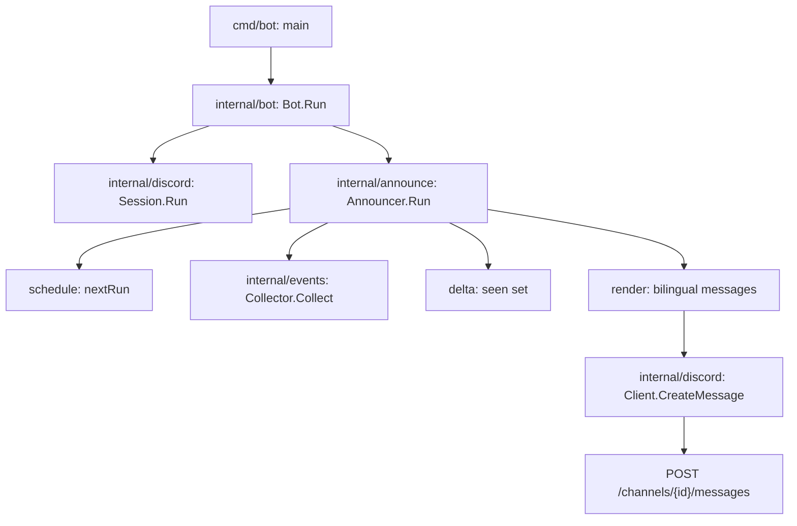

# Technical spec: FR-0002 · Scheduled announcement

**Complexity:** medium

## 1. Technical summary

**What.** A new `internal/announce` package that owns the timer, decides what is new, renders it in Spanish and
English, and posts it to one Discord channel; three additions to `internal/discord` so a message can be created at all;
one new configuration variable; and the wiring in `internal/bot` that gives the timer an owner.

**Why the timer cannot hang off the gateway.** The obvious place to start a periodic job in this repository is
`Bot.onReady`, next to the command publish — and it is the wrong one. `onReady` fires on every fresh `READY`, and
`Session.Run` reconnects with backoff and drops its session id whenever a resume is rejected, so a bad afternoon on
Discord's side would post the digest five times. The scheduler is therefore owned by `Bot.Run` directly, as a
goroutine cancelled by the same context and awaited by the same `WaitGroup` the repository requires of every goroutine,
and it never observes the gateway at all.

> **Amended 2026-11-16 (the move to Lambda, personal-infra AD-21).** The two sections below describe the in-process
> design. On Lambda, EventBridge Scheduler invokes each run; `nextRun` only names the next slot in the run's log line.
> The seen set became a per-calendar record in DynamoDB (`internal/state`), saved before anything is published, and a
> failed calendar keeps its record. Spec-0001's amended *Delta detection* paragraph and NFR-0002 are authoritative.

**Why the schedule is wall-clock rather than a ticker.** `time.NewTicker(24*time.Hour)` measures elapsed process time.
The image publishes on every push to the default branch and the container restarts on each deploy, so an elapsed-time
ticker would drift with deployments and never complete a cycle on a busy week; the monotonic clock it reads also does
not advance across a host suspend. Computing the next 13:00 UTC from the wall clock makes a restart cost nothing: the
next run is at the same instant it would have been, and a slot that passed while the process was down is not replayed.
That single property is what makes de-duplication cheap enough to keep in memory.

**Why in-memory de-duplication is safe here.** The seen set is seeded silently: the first successful run of a process
records what is currently listed and announces nothing. A restart therefore cannot re-announce, at the price of missing
an event that appeared while the process was down — a miss, not a duplicate, and the Monday digest recovers it if it
falls in that week. That is the trade the PRD chose, and it is what keeps the published claim of no persistent storage
true.

**Scope**

- **Included:** the wall-clock scheduler; the seen set with silent seeding; the daily delta message; the Monday digest
  with its seven-day list and horizon block; bilingual rendering with Discord timestamp markup and markdown escaping;
  message chunking to three messages; the create-message endpoint, its allowed-mentions and flags; the announcement
  channel configuration; the single outcome log line; the bot wiring.
- **Deferred outside this PRD:** reminders as an event approaches, editing or pinning a living message, reading channel
  history, and any second channel (PRD §9).

**Requirements / business rules** (from the PRD's FR-0002 Capabilities block)

| Rule | Value |
| ---- | ----- |
| Run slot | 13:00 UTC daily (08:00 America/Lima, a fixed UTC-5 offset, no DST) |
| Weekly run | the run whose slot falls on a Monday |
| First run of a process | seeds the seen set, announces no delta; the digest still publishes |
| Delta display cap | 10 events, then an overflow line with the remainder |
| Messages per run | at most 3 |
| Digest window | the seven days beginning on the run's day, by each event's own local day |
| Horizon block | at most 5 conferences within six months, soonest first |
| Daily notification | suppressed |
| Digest notification | normal |
| Mentions | never resolved, on create and on any edit |
| Overrun | a run that outlasts its next slot skips that slot and logs |

**UX flows.** On a normal day with news the member sees one message headed in Spanish and English, each event with its
start rendered in the member's own time zone plus a countdown, a place or a virtual marker, the organizing group, and a
link. On a Monday they see the digest first, then the daily message only if something is new. On a quiet day they see
nothing. No message ever pings anyone, and only the digest reaches a phone.

**Applicable NFRs**

| NFR | How this spec meets it |
| --- | ---------------------- |
| NFR-0001 No third-party dependencies | stdlib only; the Discord client already exists in this module. |
| NFR-0002 No personal information stored (amended 2026-11-16) | The per-calendar record goes through `announce.Store` into DynamoDB (`internal/state`); it holds public event identities, counts and digest dates only. |
| NFR-0003 No new platform privileges | No intent change. The bot needs `VIEW_CHANNEL` and `SEND_MESSAGES` on the channel and nothing else — not `READ_MESSAGE_HISTORY`, not `EMBED_LINKS`, not `MENTION_EVERYONE`. |
| NFR-0006 Log hygiene | The outcome line carries counts, statuses and times. No title, no channel content, no user identifier is ever logged. |
| NFR-0007 No unintended mentions | `allowed_mentions.parse` is an empty array on every create. |
| NFR-0008 Owned concurrency | The scheduler goroutine is started by `Bot.Run`, cancelled by its context and awaited before it returns. |
| NFR-0009 Bounded I/O | Every post goes through the existing client, which carries a 30-second timeout and 429 handling. |
| NFR-0010 Attribution | Every message names both calendars and links every event. |
| NFR-0011 Bilingual framing | Framing strings live in one table addressed by identifier; upstream text is never translated. |
| NFR-0013 Deterministic tests | `nextRun` is a pure function of the clock; a run is exercised by calling it directly with an injected instant and a fake publisher. No test sleeps. |

**Assumptions / decisions**

| Assumption | Origin |
| ---------- | ------ |
| Messages are plain content with suppressed link previews, not rich embeds. | Auto-Accept — see §3. It keeps `EMBED_LINKS` off the permission list. |
| The run hour is a constant, not configuration. The PRD fixes it. | PRD FR-0002 Capabilities |
| An empty announcement channel variable disables the feature rather than failing startup. | Auto-Accept: the bot must stay usable as a command bot without it. |
| Spanish precedes English in every framing string. | User's interview answer |
| An event that disappears upstream and returns is announced again. | PRD FR-0002 Capabilities |

## 2. Architecture impact

**New files**

- `internal/announce/announce.go`, `schedule.go`, `delta.go`, `render.go`
- `internal/announce/announce_test.go`, `schedule_test.go`, `delta_test.go`, `render_test.go`

**Modified files**

- `internal/discord/rest.go` — `Client.CreateMessage`
- `internal/discord/types.go` — `Message`, `AllowedMentions`, `NoMentions`, two message flags
- `internal/discord/rest_test.go` — the create-message tests
- `internal/config/config.go` — `DISCORD_EVENTS_CHANNEL_ID`
- `internal/config/config_test.go` — its cases
- `internal/bot/bot.go` — build the announcer, own its goroutine in `Run`



## 3. Technical decisions

| Decision | Chosen approach | Alternative considered | Trade-off | Origin |
| -------- | --------------- | ---------------------- | --------- | ------ |
| Where the goroutine lives | `Bot.Run` starts it, cancels it through the shared context, waits for it before returning | `Bot.onReady` | `Bot.Run` stops being a one-line pass-through, in exchange for a timer that a gateway reconnect cannot fire | Codebase pattern (`Session.connect`'s unwind order) + research r8 H2 |
| Schedule source | Next occurrence of a fixed UTC hour, recomputed after each run | `time.NewTicker(24h)` | A wall-clock computation on every iteration, against a ticker that drifts with deploys and stalls across host suspend | Auto-Accept (research r8 H3) |
| Message format | Plain `content` with `SUPPRESS_EMBEDS` | Rich embeds | 2,000 characters per message instead of 4,096, so chunking matters more — but the bot needs no `EMBED_LINKS` permission, and ten links do not become ten preview cards | Auto-Accept |
| Time rendering | Discord timestamp markup for exact starts; a plain date range for date-only ones | Formatting in a fixed zone | Each reader sees their own local time and a live countdown, and the date-only calendar is never made to look like it published a clock time | Auto-Accept (research r5 §6, r7 §4) |
| Seeding | First successful run records and stays silent | Announce everything on first run | A redeploy is silent instead of posting a hundred events | PRD AC-0001.03 |
| Overrun | Skip the missed slot, log, wait for the next | Run immediately | A slow upstream cannot cause two runs in a row | PRD AC-0001.07 |
| Publishing failure | Stop the run on 401/403, log once, never retry | Retry with backoff | A permission mistake stops instead of becoming ten thousand rejected requests, which is the documented way to earn an address-level block | Research r5 §5, §8 |
| Partial publish | Count the run as successful and keep the seen set updated | Roll back the seen set | The messages that did publish are not repeated tomorrow; the ones that did not are lost. Repetition is the more visible failure | PRD FR-0002 Error handling |

## 4. Component summary

| File path | New/Modified | Purpose | Key responsibilities |
| --------- | ------------ | ------- | -------------------- |
| `internal/announce/announce.go` | New | The announcer | Holds the collector, publisher, channel and seen set; `Run` blocks until the context is cancelled; `runOnce` performs one run and emits the single outcome line |
| `internal/announce/schedule.go` | New | Wall-clock schedule | `nextRun` as a pure function of an instant; the daily/weekly kind of a slot |
| `internal/announce/delta.go` | New | Seen set | Seeds silently on the first successful run; returns what is new; forgets what disappeared; leaves itself untouched when every calendar failed |
| `internal/announce/render.go` | New | Bilingual rendering | Framing strings; Discord timestamp markup; markdown escaping; the daily message, the digest, the horizon block; chunking to at most three messages under the content limit |
| `internal/discord/rest.go` | Modified | Create message | `CreateMessage(ctx, channelID, Message)` through the existing `do`, so 429 handling and error redaction are inherited |
| `internal/discord/types.go` | Modified | Message types | `Message`, `AllowedMentions`, `NoMentions`, `FlagSuppressEmbeds`, `FlagSuppressNotifications` |
| `internal/config/config.go` | Modified | Configuration | `DISCORD_EVENTS_CHANNEL_ID`, optional, digits only when set |
| `internal/bot/bot.go` | Modified | Wiring | Builds the announcer when a channel is configured; owns its goroutine in `Run` |

## 5. API contracts

**Endpoint: create message** (consumed)

- **Method:** POST
- **Path:** `/channels/{channel.id}/messages`
- **Authentication:** the bot token, as every other call in this client
- **Permissions:** `VIEW_CHANNEL` and `SEND_MESSAGES` on the channel. Nothing else.

**Request**

| Field | Type | Required | Validation | Description |
| ----- | ---- | -------- | ---------- | ----------- |
| `content` | string | Yes | ≤ 2000 characters | The rendered message |
| `flags` | integer | No | bitfield | `4` suppresses link previews, `4096` suppresses notifications; `4100` is both |
| `allowed_mentions` | object | Yes | `{"parse": []}` | Always sent. The default when omitted parses everything, and the text is written by strangers |

**Request example**

```json
{
  "content": "**📅 Nuevos eventos cloud native · New cloud native events**\n\n**KCD Panamá 2026**\n<t:1789344000:f> (<t:1789344000:R>) · 📍 Ciudad de Panamá · 👥 KCD Panamá\nhttps://ocgroups.dev/cncf/group/abc/event/xyz",
  "flags": 4100,
  "allowed_mentions": { "parse": [] }
}
```

**Response:** a message object. The announcer reads nothing from it; it is decoded into nothing and discarded.

**Error codes**

| Code | HTTP status | Handling |
| ---- | ----------- | -------- |
| `PUBLISH_DENIED` | 403 | Stop the run, log once, no retry |
| `PUBLISH_UNAUTHENTICATED` | 401 | Stop the run, log once, no retry |
| `PUBLISH_RATE_LIMITED` | 429 | Handled by the existing client, which waits `retry_after` up to its ceiling |
| `PUBLISH_PARTIAL` | any, after ≥ 1 success | Stop, log how many published, keep the seen set updated |
| `CHANNEL_MISSING` | 404 | Log once; the scheduler keeps running |

**Configuration**

| Variable | Required | Default | Validation |
| -------- | -------- | ------- | ---------- |
| `DISCORD_EVENTS_CHANNEL_ID` | No | empty — the announcer does not start | Digits only when set; anything else fails startup, because a mistyped id is silently unusable otherwise |

## 6. Data model

No database. Two in-memory structures on the `Announcer`.

**Seen set** — `map[string]struct{}` keyed by `events.Event.Identity()`, replaced wholesale on every successful run so
that identities which disappear upstream are forgotten. Bounded by the active window, roughly 100 entries. `seeded
bool` records whether the first successful run has happened.

**Run outcome** — the fields of the single log line: `kind` (daily or weekly), per-calendar `status` and `records`,
`skipped`, `events` after normalization, `delta`, `messages`, `next`. Nothing else may appear in it.

## 7. Testing strategy

| Test file | Type | Target | Goal |
| --------- | ---- | ------ | ---- |
| `internal/announce/schedule_test.go` | Unit | `nextRun` | Every boundary, no sleeping |
| `internal/announce/delta_test.go` | Acceptance | Seen set | Seeding, delta, forgetting, failure |
| `internal/announce/render_test.go` | Acceptance | Rendering | Framing, timestamps, escaping, chunking, caps |
| `internal/announce/announce_test.go` | Acceptance | One run, end to end | Against a fake publisher and a stub collector |
| `internal/discord/rest_test.go` | Unit | `CreateMessage` | Body, flags, allowed mentions, errors |
| `internal/config/config_test.go` | Unit | Channel id | Optional, validated |

| Test function | Description | PRD reference | Assertions |
| ------------- | ----------- | ------------- | ---------- |
| `TestNextRunIsTheNextThirteenHundredUTC` | Before, at and after the slot | AC-0001.01 | Always strictly in the future, always 13:00 UTC |
| `TestNextRunNeverReplaysAMissedSlot` | A process starting at 14:00 waits for tomorrow | AC-0007.02 | Next run is tomorrow's slot |
| `TestRunKindIsWeeklyOnMonday` | Kind of a slot | AC-0002.01 | Monday is weekly, every other day daily |
| `TestDeltaIsEmptyOnTheFirstRun` | Silent seeding | AC-0001.03 | Empty delta, set recorded |
| `TestDeltaReportsOnlyNewIdentities` | Second run | AC-0001.02 | Exactly the new identity |
| `TestDeltaIsEmptyWhenNothingChanged` | Idempotence | AC-0001.04 | Empty |
| `TestDeltaReannouncesAReturningEvent` | Forgetting | FR-0002 Capabilities | Reported new on reappearance |
| `TestDeltaIgnoresAFailedRun` | Guard integrity | AC-0006.06 | Set unchanged after a run with no healthy calendar |
| `TestRenderDailyIsBilingual` | Framing | NFR-0011 | Spanish and English present; the title verbatim |
| `TestRenderUsesDiscordTimestampsForExactStarts` | Reader-local time | AC-0005.04 supporting | `<t:` and `:R>` present for a community event |
| `TestRenderUsesAPlainRangeForDateOnlyEvents` | No invented clock time | AC-0003.03 | No `<t:` for a conference event; both dates shown |
| `TestRenderMarksAPlaceholderDate` | TBA | AC-0003.04 | The bilingual marker, no date |
| `TestRenderEscapesMarkdown` | Hostile titles | AC-0005.02 | Formatting characters escaped; the mention token cannot ping even before allowed mentions |
| `TestRenderCapsTheDeltaAtTen` | Overflow | AC-0001.05 | Ten events plus an overflow line with the remainder and a link |
| `TestRenderChunksAtTheContentLimit` | Message limit | AC-0004.02 | No chunk over 2000 characters; at most three; the last carries the overflow line |
| `TestRenderNamesBothCalendars` | Attribution | AC-0005.05 | Both source names present |
| `TestRenderDigestListsTheComingSevenDays` | Window | AC-0002.02 | Only events whose local day is in range, in order |
| `TestRenderDigestSaysSoWhenTheWeekIsEmpty` | Empty week | AC-0002.04 | The bilingual empty line, message still produced |
| `TestRenderHorizonListsAtMostFiveConferences` | Horizon | AC-0003.01, AC-0003.02 | At most five, soonest first |
| `TestRenderHorizonIsOmittedWhenEmpty` | Horizon | AC-0003.05 | No horizon heading |
| `TestRunPublishesNothingOnAQuietDay` | Silence | AC-0001.04 | The publisher was never called |
| `TestRunSuppressesNotificationsOnTheDaily` | Notification hygiene | AC-0001.06 | Flags carry suppress-notifications |
| `TestRunDoesNotSuppressNotificationsOnTheDigest` | Notification hygiene | AC-0002.06 | Digest flags carry no suppress-notifications |
| `TestRunPublishesTheDigestBeforeTheDaily` | Monday order | AC-0002.05 | Digest first, daily second, at most two groups |
| `TestRunPublishesTheDigestOnAFirstRun` | Seeding does not suppress the digest | AC-0002.03 | Digest published, no daily |
| `TestRunStopsPublishingOnADeniedPost` | Circuit break | FR-0002 Error handling | One call, no retry |
| `TestRunLogsOneOutcomeLine` | Observability | AC-0006.05 | Exactly one line, carrying kind, counts, delta, messages, next run |
| `TestRunLogsNoEventText` | Log hygiene | NFR-0006 | No title, place or URL appears in any log record |
| `TestRunSkipsASlotItOverran` | Overrun | AC-0001.07 | The skipped slot is logged and not run |
| `TestAnnouncerDoesNotStartWithoutAChannel` | Configuration | AC-0006.07 | `Run` returns immediately, logging once |
| `TestCreateMessageSendsContentFlagsAndAllowedMentions` | Endpoint | NFR-0007 | Path, body fields, `parse` is an empty array |
| `TestCreateMessageSurfacesAPIErrors` | Endpoint | FR-0002 Error handling | `*APIError` with the status |
| `TestLoadAcceptsAnEventsChannel` | Configuration | — | Parsed when digits |
| `TestLoadRejectsANonNumericEventsChannel` | Configuration | — | Startup error |

**Integration criteria.** All thirteen `IC-0002.MM` verify the flow from FR-0001's output into this FR. They are
covered by `announce_test.go` driving a stub collector that returns a controlled `events.Set` and `[]events.Health`,
which is exactly the contract FR-0001 provides:

| IC | Test |
| -- | ---- |
| IC-0002.01 | `TestDeltaIsEmptyOnTheFirstRun`, `TestRunPublishesTheDigestOnAFirstRun` |
| IC-0002.02 | `TestDeltaReportsOnlyNewIdentities`, `TestRunSuppressesNotificationsOnTheDaily` |
| IC-0002.03 | `TestRunPublishesNothingOnAQuietDay` |
| IC-0002.04 | `TestDeltaReannouncesAReturningEvent` |
| IC-0002.05 | `TestRenderUsesDiscordTimestampsForExactStarts`, `TestRenderUsesAPlainRangeForDateOnlyEvents` |
| IC-0002.06 | `TestRenderEscapesMarkdown`, `TestCreateMessageSendsContentFlagsAndAllowedMentions` |
| IC-0002.07 | `TestRenderDailyIsBilingual` (asserts the link) |
| IC-0002.08 | `TestRunPublishesTheDigestBeforeTheDaily` |
| IC-0002.09 | `TestRenderDigestSaysSoWhenTheWeekIsEmpty` |
| IC-0002.10 | `TestRenderHorizonListsAtMostFiveConferences`, `TestRenderMarksAPlaceholderDate` |
| IC-0002.11 | `TestRenderChunksAtTheContentLimit`, `TestRenderCapsTheDeltaAtTen` |
| IC-0002.12 | `TestRunPublishesNothingWhenEveryCalendarFailed` |
| IC-0002.13 | `TestRunPublishesWhenOneCalendarFailed` |
