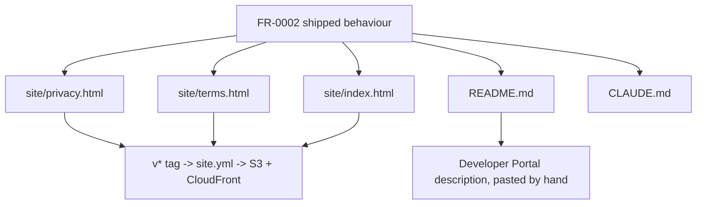

# Technical spec: FR-0003 · Policy alignment

**Complexity:** simple

## 1. Technical summary

**What.** Editing the four published documents — `site/privacy.html`, `site/terms.html`, `site/index.html` and
`README.md` — plus `CLAUDE.md`, so that every claim they make remains literally true once the bot posts on a timer and
fetches two third-party listings. No code changes and no new files.

**Why.** `CLAUDE.md` states the rule this FR exists to satisfy: the policy pages make specific factual claims about
behaviour, and *"any change to intents, storage, or the fields passed to `logger.*` falsifies one of those claims —
update `site/privacy.html` in the same change"*. It also requires §2 of the Terms to be widened rather than letting the
pages describe a narrower bot than the one that ships. The announcer changes two of the three load-bearing facts: the
bot now acts without a command behind it, and it now talks to hosts that are not Discord or AWS.

**Why most of the policy survives untouched.** The design chosen in the PRD keeps de-duplication state in memory,
requests no new gateway intent, and never reads the announcement channel. That is what saves the document's strongest
sentences. *"The Bot keeps no database. It has no persistent storage of any kind"* stays true, because a set of event
identifiers that dies with the process is not storage. *"It cannot read your messages, because it does not request the
permission that would let it"* stays true, because Read Message History is never requested — had the design read back
its own posts for de-duplication, that sentence would have had to go, and with it the GDPR withdrawal clause and the
Peruvian *banco de datos* argument. The edits below are therefore confined to two facts: **the bot acts on a timer**,
and **two new third parties are involved**.

**Scope**

- **Included:** the six edits to `site/privacy.html`, the three to `site/terms.html`, the one to `site/index.html`,
  the three to `README.md`, and the one to `CLAUDE.md`. The transcription of the new Developer Portal description.
- **Deferred:** nothing. This FR has no essential/full split.
- **Explicitly not changed:** every storage claim, every intent claim, every "cannot read your messages" claim, the
  GDPR legal-basis paragraph and the Peruvian data-bank paragraph — see §3 for the reasoning per claim.

**Requirements / business rules** (from the PRD's FR-0003 Capabilities block)

| Rule | Value |
| ---- | ----- |
| Effective date | unchanged — 14 August 2026 |
| Last updated | 20 August 2026, on both policy pages |
| Published file set | unchanged: `index.html`, `terms.html`, `privacy.html`, `404.html`, `style.css` |
| Source of truth | the HTML in `site/`; no Markdown copy may be created |
| Portal description | transcribed in `README.md`; the portal itself is updated by hand |
| Release coupling | the change must be released as a `v*` tag, because `site.yml` deploys on tags while the image publishes on every push to `main` |

**UX flows.** A server administrator reading the Privacy Policy before installing the bot learns that it posts on its
own into one channel, where that content comes from, and that nothing about them is stored. A member who follows the
link from the app's "Add App" dialog sees the same two facts in the portal description.

**Applicable NFRs**

| NFR | How this spec meets it |
| --- | ---------------------- |
| NFR-0006 Log hygiene | The Logs section is extended to enumerate the new scheduled-run lines, and the sentence promising that logs record no message content, user IDs or usernames is preserved — which is a constraint the implementation of FR-0002 must honour, not a wish. |
| NFR-0010 Attribution | The Terms gain the accuracy disclaimer and the pointer to the canonical source that the attribution requirement implies. |
| NFR-0014 Release coupling | Stated in the plan's prerequisites and in the release note. |

**Assumptions / decisions**

| Assumption | Origin |
| ---------- | ------ |
| The two upstream hosts are named by their operators — the Linux Foundation and the Open Community Groups project — rather than by hostname, matching how Discord and AWS are already named. | Auto-Accept, consistent with the existing "Who else is involved" style |
| The announcement channel is not named in the policy; the policy says "one channel in the server", because the channel is deployment configuration and would date the document. | Auto-Accept |
| The edits are applied last in the release, after FR-0002, so the README's configuration table can name the variable FR-0002 introduces. | Auto-Accept (see the plan's prerequisites) |
| No new legal basis paragraph is added, because the timer path processes no personal data at all: it fetches public listings and posts a message. | Auto-Accept, following the audit's reasoning |

## 2. Architecture impact

**Modified files**

- `site/privacy.html` — 6 edits
- `site/terms.html` — 3 edits
- `site/index.html` — 1 edit
- `README.md` — 3 edits
- `CLAUDE.md` — 1 edit

No new file; the published set is fixed by the deploy workflow's guard.



## 3. Technical decisions

| Decision | Chosen approach | Alternative considered | Trade-off | Origin |
| -------- | --------------- | ---------------------- | --------- | ------ |
| How much of the callout to rewrite | Replace only the final sentence, which asserts that everything the bot receives serves a command | Rewrite the whole callout | The two strongest sentences of the document stay verbatim, so a reader comparing versions sees exactly what changed | Auto-Accept |
| Where to disclose the timer | In the callout, in "What the Bot receives", in "What the Bot cannot see", and in Terms §3 | A single new section | The false sentences live in four places; a new section would leave them false | Audit (research r1) |
| Naming the new third parties | Add one list item to "Who else is involved" | Leave the list, since no personal data reaches them | The heading presents the list as exhaustive, and a reader deserves to know the bot talks to hosts beyond Discord and AWS even when no personal data flows | Audit (research r1, claim 13) |
| Terms §2 | Widen the enumeration and add a third-party-content bullet | Leave §2 and rely on §9's general disclaimer | The enumeration *is* the scope; a global calendar is not "the community's own activities" | Audit (research r1, claim 20) |
| Claims left untouched | Storage, intents, message reading, member enumeration, withdrawal, data bank | Soften them defensively | Softening a true claim to buy margin makes the document less accurate, which is the opposite of its stated purpose | Auto-Accept |

## 4. Component summary

| File path | New/Modified | Purpose | Key responsibilities |
| --------- | ------------ | ------- | -------------------- |
| `site/privacy.html` | Modified | Data-handling disclosure | Discloses the timer, the fetched listings, the in-memory de-duplication set, the new log lines and the two new parties |
| `site/terms.html` | Modified | Terms of use | Widens the purpose to cover republished third-party event information; stops describing the bot as purely reactive; disclaims accuracy |
| `site/index.html` | Modified | Landing page | Lede mentions the scheduled event announcements |
| `README.md` | Modified | Repository documentation | Feature list, the "only dials out to Discord" claim, and the transcribed portal description |
| `CLAUDE.md` | Modified | Agent instructions | The "only dials out to Discord" claim and the policy-drift trigger list |

### Edits — `site/privacy.html`

**Edit 1 — the "Last updated" date (AC-0008.07)**

Current (line 18):

```html
    <span><strong>Last updated:</strong> 14 August 2026</span>
```

Replacement:

```html
    <span><strong>Last updated:</strong> 20 August 2026</span>
```

**Edit 2 — the callout (AC-0008.01)**

Current (lines 31-35):

```html
  <div class="callout">
    <p>The Bot keeps no database. It has no persistent storage of any kind. It cannot read your
    messages, because it does not request the permission that would let it. What it receives, it uses
    to answer the command you ran, and then discards.</p>
  </div>
```

Replacement — the first two sentences are unchanged; only the last is replaced:

```html
  <div class="callout">
    <p>The Bot keeps no database. It has no persistent storage of any kind. It cannot read your
    messages, because it does not request the permission that would let it. Two things make it act: a
    command you run, and a daily timer that posts upcoming cloud native events into one channel. What
    it receives, it uses for that, and then discards.</p>
  </div>
```

**Edit 3 — "What the Bot receives" gains the listings (AC-0008.01, AC-0008.02)**

Current (lines 45-46), the closing paragraph of the section:

```html
  <p><strong>Connection metadata.</strong> While connected, the Bot receives gateway events
  describing which servers it is in and whether they are available.</p>
```

Replacement — the existing paragraph is kept and one is added after it:

```html
  <p><strong>Connection metadata.</strong> While connected, the Bot receives gateway events
  describing which servers it is in and whether they are available.</p>
  <p><strong>Public event listings.</strong> Once a day the Bot fetches two public listings of
  upcoming cloud native events &mdash; the CNCF community group calendar and the Linux
  Foundation&rsquo;s conference calendar &mdash; so that it can announce them. Nothing about you is
  sent in those requests, and nothing about you comes back: they are the same public pages anyone can
  open in a browser.</p>
```

**Edit 4 — "What the Bot cannot see" (AC-0008.01)**

Current (lines 49-52):

```html
  <p>The Bot connects with the <code>GUILDS</code> gateway intent only. It does <strong>not</strong>
  request the privileged <code>MESSAGE CONTENT</code> or <code>GUILD MEMBERS</code> intents. In
  practice this means the Bot cannot read the contents of messages in your server, cannot enumerate
  your members, and receives nothing at all unless someone explicitly invokes one of its commands.</p>
```

Replacement — only the final clause changes:

```html
  <p>The Bot connects with the <code>GUILDS</code> gateway intent only. It does <strong>not</strong>
  request the privileged <code>MESSAGE CONTENT</code> or <code>GUILD MEMBERS</code> intents, and it
  does not request permission to read a channel&rsquo;s message history. In practice this means the
  Bot cannot read the contents of messages in your server, cannot enumerate your members, and
  receives nothing from your server at all unless someone explicitly invokes one of its
  commands.</p>
```

**Edit 5 — "What is stored" (AC-0008.03)**

Current (lines 55-56):

```html
  <p>Nothing is stored persistently. The Bot holds interaction data in memory only for as long as it
  takes to answer the command, and writes no user data to disk or to any database.</p>
```

Replacement — the first sentence is unchanged; the second is extended:

```html
  <p>Nothing is stored persistently. The Bot holds interaction data in memory only for as long as it
  takes to answer the command, and writes no user data to disk or to any database. So that it does
  not announce the same event twice, it also keeps a list of the events it has already announced;
  that list holds event identifiers published by the calendars themselves, nothing about any person,
  and it is lost whenever the Bot restarts.</p>
```

**Edit 6 — the Logs enumeration and the third-party list (AC-0008.02, AC-0008.03)**

Current (lines 60-66), the log enumeration:

```html
    <li>lifecycle events: connecting, reconnecting, session start and resume, heartbeat health;</li>
    <li>the <strong>name</strong> of each command that fails or is not recognised &mdash; not its
    arguments;</li>
```

Replacement — one item added between them:

```html
    <li>lifecycle events: connecting, reconnecting, session start and resume, heartbeat health;</li>
    <li>each scheduled announcement run: whether it was the daily or the weekly one, how many events
    each calendar returned, how many were announced, and when the next run is due;</li>
    <li>the <strong>name</strong> of each command that fails or is not recognised &mdash; not its
    arguments;</li>
```

And in "Who else is involved", after the Amazon Web Services item (line 82-85), one item is added:

```html
    <li><strong>The event calendars</strong> the Bot reads once a day: the CNCF community group
    calendar, run by the Open Community Groups project, and the Linux Foundation&rsquo;s conference
    calendar. The Bot only reads their public listings; it sends them nothing about you, and it has
    no account with either.</li>
```

### Edits — `site/terms.html`

**Edit 7 — the "Last updated" date (AC-0008.07)**

Current (line 18): `<span><strong>Last updated:</strong> 14 August 2026</span>` →
`<span><strong>Last updated:</strong> 20 August 2026</span>`.

**Edit 8 — §2 purpose (AC-0008.04)**

Current (lines 34-37):

```html
  <p>The Bot is a community tool for <strong>educational and informational purposes only</strong>. It
  exists to help members of the Cloud Native Ayacucho Community (CNAYP) learn: sharing links to
  learning material, pointing to documentation, announcing meetups and study sessions, and answering the
  community&rsquo;s own questions about its activities.</p>
```

Replacement:

```html
  <p>The Bot is a community tool for <strong>educational and informational purposes only</strong>. It
  exists to help members of the Cloud Native Ayacucho Community (CNAYP) learn: sharing links to
  learning material, pointing to documentation, announcing meetups and study sessions, announcing
  publicly listed cloud native events organised by others, and answering the community&rsquo;s own
  questions about its activities.</p>
```

And one bullet is added to the list that follows, after the "Educational material may be inaccurate" item:

```html
    <li>Event information is republished from public calendars the Operator does not control. Dates,
    venues, prices, and whether an event happens at all can change or be wrong. Every announcement
    links to the organiser&rsquo;s own page &mdash; treat that page, not the Bot, as the source of
    truth before you travel or register.</li>
```

**Edit 9 — §3 the service (AC-0008.05)**

Current (lines 54-55):

```html
  <p>The Bot is a Discord application that responds to slash commands in servers where it has been
  installed. It is provided free of charge, for community use.</p>
```

Replacement:

```html
  <p>The Bot is a Discord application installed in servers by their administrators. It responds to
  slash commands, and it also acts on its own: once a day it posts upcoming cloud native events into
  a single channel chosen by the server&rsquo;s operator. It is provided free of charge, for
  community use.</p>
```

The paragraph that follows, about the `GUILDS` intent, is unchanged.

### Edit — `site/index.html`

**Edit 10 — the lede (AC-0008.06)**

Current (lines 13-15):

```html
  <p class="lede">A Discord bot for the Cloud Native Ayacucho Community (CNAYP), operated by Ken
  Esparta. It is used for educational and informational purposes only: sharing learning material,
  pointing to documentation, and announcing the community&rsquo;s meetups and study sessions.</p>
```

Replacement:

```html
  <p class="lede">A Discord bot for the Cloud Native Ayacucho Community (CNAYP), operated by Ken
  Esparta. It is used for educational and informational purposes only: sharing learning material,
  pointing to documentation, announcing the community&rsquo;s meetups and study sessions, and posting
  upcoming cloud native events from public calendars.</p>
```

The callout below it is unchanged: the bot still cannot read messages and still stores nothing.

### Edits — `README.md`

**Edit 11 — the opening description (AC-0008.06).** The sentence listing the two slash commands is extended to
mention that the bot also posts scheduled event announcements into one channel.

**Edit 12 — the "Policy site" claim (AC-0008.06).** The sentence *"The bot itself serves no HTTP; it only dials out to
Discord."* becomes a statement that the bot still serves no HTTP and has no listener, but now dials out to Discord and
to the two public event calendars. The bolded drift-trigger sentence that follows gains outbound third-party calls to
its list of changes that require a Privacy Policy update.

**Edit 13 — the transcribed portal description (AC-0008.06).** Current:

> A bot for the Cloud Native Ayacucho Community (CNAYP). Shares learning material, documentation and
> meetup announcements. Educational and informational use only; it cannot read your messages and
> stores nothing.

Replacement:

> A bot for the Cloud Native Ayacucho Community (CNAYP). Shares learning material and documentation,
> and posts upcoming cloud native events from public CNCF and Linux Foundation calendars into one
> channel on a daily schedule. Educational and informational use only; it cannot read your messages
> and stores nothing.

This text lives in the Discord Developer Portal, not in git. The README transcription is what makes it reviewable;
**a human must paste the new text into the portal by hand**, and no CI check can detect that it was forgotten.

### Edit — `CLAUDE.md`

**Edit 14.** The "Policy site" section states *"The bot process serves no HTTP at all — it only dials out to Discord,
has no listener, no `EXPOSE`, and no published ports."* The no-listener half stays; the "only dials out to Discord"
half becomes "dials out to Discord and to the two public event calendars". The paragraph listing what falsifies the
Privacy Policy's claims gains outbound third-party requests and scheduled posting alongside intents, storage and log
fields.

## 5. Testing strategy

There is no code to unit test. Verification is a review checklist plus the one mechanical guard that already exists.

| Check | Type | PRD reference | How |
| ----- | ---- | ------------- | --- |
| Every edit applied, none missed | Review | AC-0008.01 … AC-0008.06 | Walk §4 of this spec against the diff; each edit names the AC it satisfies |
| The published file set is intact | Mechanical | — | The existing guard step in `.github/workflows/site.yml` fails the build if any of the five files is missing |
| Both pages render and their links resolve | Manual | — | `python3 -m http.server -d site 8000`, open all three pages, follow every internal link |
| No surviving claim is falsified | Review | AC-0008.03 | Re-read the whole of `privacy.html` and `terms.html` after editing, not only the edited spans, against the shipped behaviour of FR-0002 |
| The log-hygiene promise holds in code | Cross-FR review | AC-0008.03 | Grep FR-0002's `logger.*` calls: no event title, no channel content, no user identifier may appear |
| The portal description was actually pasted | Manual, uncheckable by CI | AC-0008.06 | Confirm in the Developer Portal before tagging |
| The release is tagged | Manual | AC-0008.07 | `site.yml` deploys on `v*` only; merging to `main` alone ships the behaviour without the policy |

**Regression risk to watch.** If FR-0002's implementation ever logs an event title or a channel identifier, Edit 6
becomes a false statement and the log-hygiene promise in the untouched paragraph below it becomes false too. That
paragraph is the reason NFR-0006 exists.
