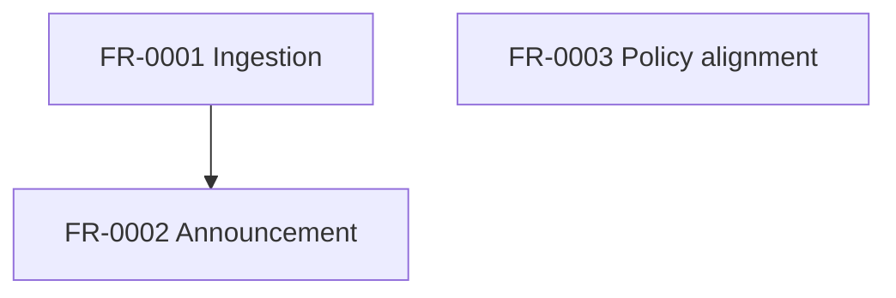

# Spec 0001 — CNCF Events Announcer

> [!info] How to use this document
> This is the **source of truth** for WHAT the announcer does. Stack and internal architecture are **not** decided here
> (they are decided in the per-feature technical specs generated by `eng-spec-writer`).
>
> - Doubts are marked `[NEEDS CLARIFICATION: question]` — do not invent.
> - Every requirement has a stable ID (`US-NNNN`, `AC-NNNN.MM`, `FR-NNNN`, `NFR-NNNN`, `IC-NNNN.MM`) so it can be
>   referenced from the specs, the plans and the tests.
> - Do not move on to the technical specs until **all** `[NEEDS CLARIFICATION]` markers are resolved or consciously
>   accepted as open.

## 1. Executive summary

The CNCF Events Announcer is a scheduled capability added to the existing Cloud Native Ayacucho Community (CNAYP)
Discord bot. Once a day it reads three public listings of upcoming cloud native events — the CNCF community-group
calendar, the Linux Foundation's CNCF conference calendar, and the CNCF website's listing of community-run
Kubernetes Community Days — and publishes what it finds into a single announcements channel, in Spanish and English.

It is written for members of a volunteer community who want to know which meetups, Kubernetes Community Days and
KubeCon editions are coming up worldwide, without following a dozen calendars themselves. The differentiator is
restraint: the bot announces each event once, on the day it first appears in the calendar, and adds one weekly digest
of the coming week. A day with nothing new is a day with no message. Members are never asked to subscribe, and no
personal data is involved in any part of the flow.

At a high level, a wall-clock scheduler fires once a day at a fixed hour, both sources are fetched, their records are
normalized into a single event shape, filtered and collapsed so a recurring monthly call does not dominate the output,
compared against what the bot has already announced during its current lifetime, and the difference is rendered into
at most three Discord messages. The bot keeps nothing on disk, requests no new gateway intents, and does not read the
channel it posts into.

## 2. Problems and opportunities

**Main problem**

- CNCF event information is fragmented across at least four platforms, and the community-group calendar alone carries
  98 events in a six-month window that no member tracks by hand.
- Regional relevance is invisible from a raw calendar: of those 98 events, 0 are in Peru and 11 are in Latin America,
  so a member scanning the list gets no signal about what they could realistically attend.
- Flagship conferences — KubeCon and its co-located days — live in a completely separate listing from local meetups,
  so a member watching one calendar systematically misses the other. The Kubernetes Community Days, which are the
  events closest to what a regional community could attend or emulate, are in a third listing again and appear in
  neither of the first two.
- Announcement channels decay into noise: a quarter of the community-group calendar is a handful of recurring working
  group calls, and any naive "post the calendar" bot would repeat them weekly until the channel is muted.
- The community has no reliable heartbeat for event news; announcements happen when a volunteer remembers to make one.

**Opportunities**

- One channel, two calendars merged, each event announced exactly once — the fragmentation problem disappears without
  asking anyone to change their habits.
- Announcing on the day an event is *first listed* turns a static calendar into news, which is what a Discord channel
  is good at, while a weekly digest preserves the "what is coming up" view a calendar is good at.
- Collapsing recurring series to their next occurrence, and staying silent on quiet days, is what separates a useful
  feed from a muted one — and it costs nothing but a rule.
- The bot already runs, is already trusted with a narrow permission set, and already publishes its data handling in a
  public policy. Adding the announcer inside those constraints — no storage, no message reading, no new intents —
  keeps that trust intact instead of spending it.

## 3. Target audience and stakeholders

**Users and stakeholders**

- **Primary user** — a member of the CNAYP Discord server who reads the announcements channel.
- **End user** — the same person; the bot exposes no other surface for this capability.
- **Other stakeholders** — the **bot operator** (who runs the container, reads the logs and answers for the published
  privacy policy), and the **upstream publishers** (CNCF community-group organizers and the Linux Foundation events
  team) whose content is being republished.

**Main users (personas)**

- **The local learner**
    - Based in Ayacucho or elsewhere in Peru; attends online events and occasionally travels within Latin America.
    - Wants to know which events are virtual and therefore attendable, and cares about Spanish-language events.
    - Reads Discord on a phone, and mutes any channel that pushes daily notifications.

- **The community organizer**
    - Runs or helps run CNAYP activities; watches what other chapters are doing for ideas and for dates to avoid.
    - Wants the full global picture including in-person meetups abroad, and wants flagship conference dates early
      enough to plan a CFP submission or a watch party.
    - Will notice immediately if the feed goes quiet or starts repeating itself.

- **The bot operator**
    - Runs the container, cuts the releases, and is named in the published Privacy Policy.
    - Needs every run to be visible in the logs, and needs a broken upstream to be loud rather than silent.
    - Will not accept a change that adds persistent storage, a privileged intent, or a claim the policy pages
      contradict.

**Behavioral profile**

- All three read the channel passively; none of them invoke a command to get this content.
- All three treat repetition as a defect, and silence as an acceptable state.
- All three depend on the same single channel; there is no per-user configuration anywhere in this product.

## 4. Goals

- **Announce** every newly listed CNCF event exactly once, on the first scheduled run after it appears upstream.
    - Metric: 0 duplicate announcements of the same upstream event within a process lifetime, and 0 duplicate
      announcements caused by a container restart, measured over a 30-day observation window.

- **Cover** both the community-group calendar and the flagship conference calendar in a single feed.
    - Metric: 100% of the events returned by the two configured sources for the active window are either announced,
      collapsed into an announced series, or filtered by a stated rule — no event is dropped silently.

- **Protect** the channel from noise so it stays unmuted.
    - Metric: at most 3 messages per scheduled run, at most 2 runs producing messages on any given day, and 0 posts on
      a day with no new events.

- **Fail loudly** rather than going quietly wrong.
    - Metric: 100% of scheduled runs emit an outcome log line naming the run kind, the per-source record counts and
      the next scheduled run; a source returning zero records produces an error-level log and no post.

- **Keep** the published policy pages true on the day the feature ships.
    - Metric: 0 statements in `site/privacy.html`, `site/terms.html`, `README.md` or the Developer Portal description
      that the shipped behaviour contradicts, verified by review in the same change.

## 5. User stories (capabilities)

### US-0001 · Daily announcement of newly listed events

**As a** community member, **I want** the bot to tell me when a new cloud native event appears on the CNCF calendars,
**so that** I hear about it as news instead of discovering it the week it happens.

Criteria:

- AC-0001.01 — The daily run fires once every day at 13:00 UTC (08:00 America/Lima, a fixed UTC-5 offset with no DST).
- AC-0001.02 — A run announces only events that were absent from the previous successful run of the same process and
  are present now.
- AC-0001.03 — The very first run after the process starts announces nothing; it records the current event set and
  returns. A restart therefore never re-announces an already-announced event.
- AC-0001.04 — When the computed set of new events is empty, the run posts no message at all.
- AC-0001.05 — When the set of new events exceeds 10, the run announces the 10 with the earliest start and appends a
  single line stating how many further events were added, with a link to the source listing.
- AC-0001.06 — Daily announcement messages are delivered without triggering push or desktop notifications.
- AC-0001.07 — A run that fires while the previous run is still in progress is skipped, and the skip is logged.

### US-0002 · Weekly digest of the coming week

**As a** community member, **I want** a weekly summary of the events happening in the next seven days, **so that** I
have a predictable place to look and nothing that was announced mid-week gets lost.

Criteria:

- AC-0002.01 — A digest is published every Monday at 13:00 UTC, in the same run slot as the daily announcement.
- AC-0002.02 — The digest lists every event whose local start day falls within the seven days beginning on the day of
  the run, ordered by start instant, earliest first.
- AC-0002.03 — The digest is published even when it is the first run after the process starts, and even when the
  week's list is identical to the previous week's, because it is computed only from the current calendars.
- AC-0002.04 — When the seven-day list is empty, the digest states that no events are scheduled for the week rather
  than being omitted.
- AC-0002.05 — On a Monday, the digest is published first and the daily announcement of new events follows as a
  separate message only when that set is non-empty, for a maximum of 2 message groups that day.
- AC-0002.06 — The digest is delivered with normal notification behaviour.

### US-0003 · Horizon view of flagship conferences

**As a** community organizer, **I want** the upcoming flagship conferences to be visible months ahead, **so that** I
can plan a talk submission, a trip or a watch party instead of learning about KubeCon seven days before it starts.

Criteria:

- AC-0003.01 — The Monday digest ends with a horizon block listing conferences — flagship and community-run alike —
  starting within the next 6 months.
- AC-0003.02 — The horizon block lists at most 5 conferences, the soonest first.
- AC-0003.03 — Each horizon entry shows the conference name, its date range and its city and country, or a virtual
  marker when the source declares the event virtual.
- AC-0003.04 — A conference whose source publishes no confirmed date is listed with an explicit "date to be announced"
  marker rather than being dropped or given an invented date.
- AC-0003.05 — When no flagship conference falls within the horizon, the block is omitted entirely.

### US-0004 · A channel worth leaving unmuted

**As a** community member, **I want** the feed to stay short and non-repetitive, **so that** I keep the channel
unmuted.

Criteria:

- AC-0004.01 — A recurring series is represented by its next occurrence only; further occurrences of the same series
  within the active window are not listed.
- AC-0004.02 — A run publishes at most 3 messages, and any content beyond that is replaced by a single overflow line
  stating how many entries were omitted, with a link to the source listing.
- AC-0004.03 — Events marked canceled, unpublished or test by their source are never announced.
- AC-0004.04 — An event whose start instant has already passed at the moment of the run is never announced.
- AC-0004.05 — Every entry names its event exactly once; the same event never appears twice within one message group.

### US-0005 · Safe rendering of content written by strangers

**As a** server moderator, **I want** third-party event text to be unable to ping the server or impersonate formatting,
**so that** republishing a public calendar cannot become an incident.

Criteria:

- AC-0005.01 — No message the announcer publishes ever resolves an `@everyone`, `@here`, role or user mention, whatever
  the upstream text contains, and this holds for both new messages and any later edit of them.
- AC-0005.02 — Formatting characters inside upstream titles and organizer names are neutralised so they cannot alter
  the layout of the message.
- AC-0005.03 — An event title longer than 120 characters is truncated with a visible ellipsis, and the full title
  remains reachable through the event link.
- AC-0005.04 — Every announced event carries a link to its canonical page on the source platform.
- AC-0005.05 — Every message group names the source platforms the content came from.
- AC-0005.06 — Control characters and zero-width characters present in upstream text are removed before publishing.

### US-0006 · A feed that is loud when it breaks

**As the** bot operator, **I want** upstream breakage to be visible in the logs and invisible in the channel, **so that**
a renamed upstream parameter does not turn into a channel that quietly says nothing for a year.

Criteria:

- AC-0006.01 — A source that returns a successful response containing zero events is treated as a failure: it is
  logged at error level and contributes nothing to the run.
- AC-0006.02 — A source returning fewer than 30% of the records it returned on its last successful run is treated as
  suspect: it is logged at error level and contributes nothing to the run.
- AC-0006.03 — A response that is not the expected content type, or that cannot be parsed, is a failure of that source
  only; the other source still contributes to the run.
- AC-0006.04 — A single malformed record does not discard the rest of its response; it is skipped and counted.
- AC-0006.05 — Every run emits exactly one outcome log line naming the run kind, the per-source record counts, the
  number of messages published and the next scheduled run time.
- AC-0006.06 — When every configured source fails, the run publishes nothing.
- AC-0006.07 — When the announcement channel is not configured, the scheduler does not start, and that is logged once
  at startup.

### US-0007 · Restarts and redeploys that cost nothing

**As the** bot operator, **I want** the announcer to survive a container restart without spamming or crashing, **so
that** shipping an unrelated change is never risky.

Criteria:

- AC-0007.01 — The announcer holds no state outside the running process and writes nothing to disk.
- AC-0007.02 — The scheduler computes each run from the wall clock, so a restart shifts no run and a missed slot is
  not replayed on startup.
- AC-0007.03 — The announcer's background work stops when the bot shuts down, and shutdown waits for an in-flight run
  to finish or be cancelled before the process exits.
- AC-0007.04 — A gateway reconnect never triggers a run.
- AC-0007.05 — An event that first appeared upstream while the process was down is not announced by the daily run
  after a restart; it surfaces in the next weekly digest if it falls within that week.

### US-0008 · Published policies that match the shipped bot

**As the** bot operator, **I want** the public policy pages and the app description to describe the announcer, **so
that** nobody installs or reads about a bot narrower than the one running.

Criteria:

- AC-0008.01 — The Privacy Policy states that the bot acts on a timer in addition to acting on commands.
- AC-0008.02 — The Privacy Policy names the third-party event sources among the parties involved.
- AC-0008.03 — The Privacy Policy's storage, intent and logging statements remain literally true of the shipped
  behaviour.
- AC-0008.04 — The Terms of Service scope covers republishing third-party event information and disclaims its
  accuracy, pointing to the canonical source.
- AC-0008.05 — The Terms of Service no longer describes the bot as acting only in response to commands.
- AC-0008.06 — The README and the transcribed Developer Portal description mention the scheduled announcements.
- AC-0008.07 — The policy edits ship in the same change as the feature.

## 6. Functional requirements

### 6.1 Summary table

| ID      | Requirement                                                                                                  |
| ------- | ------------------------------------------------------------------------------------------------------------ |
| FR-0001 | Event ingestion, normalization and source health (US-0003, US-0004, US-0005, US-0006)                        |
| FR-0002 | Scheduled bilingual announcement to the community channel (US-0001, US-0002, US-0003, US-0004, US-0005, US-0006, US-0007) |
| FR-0003 | Policy and documentation alignment (US-0008)                                                                 |

### 6.2 Detail per functional requirement

### FR-0001 · Event ingestion and normalization

**Provides:**

- The normalized, filtered, series-collapsed event set for the active window — each entry carrying a source-qualified
  identity, a display title, a start that is either an exact instant or a calendar date, an end where the source
  publishes one, a place or a virtual marker, an attendance kind, the organizing group for community events, a local
  calendar day, and the canonical event page address (consumed by FR-0002).
- Per-run source health — for each source, its status for this run and the number of records it contributed
  (consumed by FR-0002).

**Capabilities:**

*Community-group source.* Reads the CNCF community-group listing for a window running from one day before the run to
six months and one day after it. The window is deliberately one day wider on each side than the window that is
displayed, because the source filters on the UTC calendar day while events are shown on their own local day. The
listing is paged; the run collects every page of the window up to a ceiling of 10 pages and stops, deduplicating by
upstream identifier while paging. It yields, per record, an upstream identifier, title, start instant, end instant
when published, the event's own time zone name, attendance kind (in person, virtual, hybrid), venue name and city when
published, organizing group name and identifier, series identifier when published, status flags, and the canonical
event page address. The upstream returns roughly 98 events in a six-month window today, in a response of roughly
360 KB, most of it a pre-rendered markup blob that is discarded on read.

*Community days source.* Reads the CNCF website's event listing restricted to its community-hosted host category,
which is in practice the Kubernetes Community Days: currently 61 records of which 13 are still to come, including the
São Paulo and Panamá editions. The listing carries every community-hosted event ever held and offers no way to ask
for the upcoming ones — its date parameters are accepted and silently ignored — so the window is applied afterwards
like it is for every other calendar. Titles arrive as HTML and are decoded; dates are floating calendar dates in any
of three layouts.

*Flagship conference source.* Reads the Linux Foundation conference listing restricted to the CNCF conference
category, which returns the KubeCon editions and the CNCF-hosted co-located days, currently 24 events in a six-month
window. The listing returns upcoming events only and is not paged. It yields, per record, an upstream identifier,
name, start date, end date, city, region, country, an explicit virtual flag, and the canonical event page address.
Dates from this source are calendar dates with no clock time and no time zone, and are treated as such throughout. A
record whose start date is the literal "to be announced" placeholder is kept and marked, not dropped and not given an
invented date.

*Cross-calendar de-duplication.* An event that two calendars both carry is listed once. The case that occurs is a
Kubernetes Community Day appearing both on the CNCF website and on the community-group calendar, where the two spell
it differently — "KCD Gujarat 2026" against "Kubernetes Community Day Gujarat 2026" — so the match is made on a
canonical title, in which the spelled-out form is reduced to its abbreviation, together with the day the event starts.
Where both exist, the richer record survives: the one with an exact start time, a venue and an organizing group.

*Request discipline.* Each source is fetched at most once per scheduled run, i.e. at most once a day. Every request
identifies the bot with a descriptive agent string carrying a contact address; the conference source rejects the
runtime's default agent string outright, so a request without an explicit one fails every time. Every request has a
timeout, and any response larger than 8 MB is refused.

*Merge and normalize.* Both sources are merged into one shape. Identity is the pair of source name and upstream
identifier; identifiers from the two sources are never compared with each other, because they come from unrelated
numbering systems. Records are filtered out, in order: marked canceled, marked test, not marked published, and start
instant already in the past at the moment of the run. Recurring series are collapsed so that only the next occurrence
survives — by the source's own series identifier when it publishes one, and otherwise by the combination of the
organizing group and a normalized title with case, surrounding whitespace, punctuation and trailing occurrence
numbering removed. Display titles are truncated to 120 characters at a word boundary with a visible ellipsis. Control
characters and zero-width characters are stripped, and formatting characters are neutralised so upstream text cannot
alter the layout of a message. Each entry is assigned a local calendar day, computed from the event's own published
time zone for community-group events and taken as-is for the date-only conference records.

*Health guards.* The record count of each source's last successful fetch is kept in memory. A successful response
carrying zero records is treated as a failure of that source, because neither configured source legitimately empties.
A count below 30% of that source's last successful count is treated as suspect and that source's contribution is
discarded for the run. A single malformed record is skipped and counted rather than discarding the rest of its
response. A failure of one source never prevents the other from contributing.

**Experience:** Consumed by FR-0002 only. Nothing about this requirement is visible in Discord except through the
messages FR-0002 publishes, and no member ever waits on it, because no member triggers it. Its member-visible effect
is negative space: the recurring working group call that would otherwise appear seven times in six months appears
once, a canceled meetup never appears, and a broken upstream produces silence rather than a confidently wrong "no
upcoming events".

**Error handling:**

- `SOURCE_UNREACHABLE` — the request failed at the transport level. That source contributes nothing to the run; the
  other source proceeds.
- `SOURCE_REJECTED` — the response status is not success. Logged with the status; no retry within the run, so that a
  persistent rejection cannot become a request storm.
- `SOURCE_UNUSABLE` — the response is a success but is not the expected content type, or cannot be read as the
  expected structure. This is the documented way the community-group source degrades when a route changes, so it is
  never treated as an empty result. That source contributes nothing.
- `SOURCE_EMPTY` — the response is well formed and contains zero records. Treated as a failure, not as a quiet day.
- `SOURCE_DEGRADED` — the response carries fewer than 30% of the records of that source's last successful fetch.
  Treated as suspect; the contribution is discarded.
- `RECORD_SKIPPED` — one record is missing a mandatory field (identifier, title or start), or its date cannot be read
  in any accepted layout and it is not the explicit "to be announced" case. The record is dropped and the count of
  skipped records appears in the run outcome.

### FR-0002 · Scheduled announcement

**Consumes:**

- The normalized, filtered, series-collapsed event set for the active window from FR-0001 — source-qualified identity,
  display title, start (exact instant or calendar date), end where published, place or virtual marker, attendance
  kind, organizing group, local calendar day, canonical address.
- Per-run source health from FR-0001 — per-source status and record count.

**Capabilities:**

*Scheduling.* The next occurrence of 13:00 UTC (08:00 America/Lima, a fixed UTC-5 offset with no daylight saving) is
computed from the current wall clock and waited for, then recomputed after every run. It never fires on startup and
never replays a slot that passed while the process was down. A run whose scheduled instant falls on a Monday is a
weekly run and also carries the daily behaviour; every other day is a daily run. Only one run executes at a time; a
trigger arriving while a run is in flight is dropped and logged. The scheduler is owned by the component that starts
it, stops when that component's context is cancelled, and is waited for before shutdown completes. It does not start
at all when no announcement channel is configured. It is independent of the gateway connection, so reconnects,
resumes and session invalidations have no effect on it.

*Delta detection.* The set of source-qualified identities seen on the last successful run is held in memory only, for
the lifetime of the process. On the first successful run after the process starts, the identities are recorded and the
delta is empty, so a restart cannot re-announce. On later runs the delta is the identities that are new. Identities
that disappear upstream are removed from the record, so a re-listed event is treated as new again. A run in which
every source failed does not modify the record. The delta is capped at 10 entries for display, with the remainder
reported as a count. The record is bounded by the size of the active window, roughly 100 entries.

*Composition.* Framing text — headings, the summary line, the overflow line and the empty-week line — is bilingual,
Spanish first then English. Event titles, organizer names and place names are reproduced verbatim in their original
language and never translated. Entries carrying an exact instant are rendered so that each reader sees the start in
their own local time along with a relative countdown; entries carrying only calendar dates are rendered as a plain
date range and never as an exact instant, because the source does not publish one. Each entry shows title, start,
place or a virtual marker, organizing group for community events, and a link. Every message group names the source
platforms the content came from. A run publishes at most 3 messages; content beyond that is replaced by one overflow
line with a count and a link to the source listing.

*Weekly digest.* On a Monday run, a digest is published first, listing every entry whose local start day falls within
the seven days beginning on the day of the run, ordered by start instant. When that list is empty the digest says so
rather than being omitted. The digest closes with a horizon block listing at most 5 conferences — flagship and
community-run alike — starting within the next six months, soonest first, each with its name, date range and place or virtual marker, and with an
explicit "date to be announced" marker where the source publishes no confirmed date; the block is omitted entirely
when no conference falls within the horizon. The digest is computed only from the current event set, so it publishes
even on the first run after a restart.

*Publishing.* Everything is published to the single configured announcement channel. Daily announcements are
published without triggering push or desktop notifications; the weekly digest is published normally. No message ever
resolves a mention of any kind, whatever the upstream text contains, and this holds for any later edit of a message
as well. Exactly one outcome line is logged per run, naming the run kind, each source's status and record count, the
number of entries after filtering and collapsing, the delta size, the number of messages published and the next
scheduled run. No event payload, message content, channel content, username or person identifier is ever logged.

**Experience:** The member sees, on a normal day with news, one message headed in Spanish and English announcing the
newly listed events, each with its date shown in the member's own time zone and a countdown, each linking to its
official page. On a Monday they additionally see a digest of the week and, below it, a short horizon block of the next
flagship conferences. On a day with no news they see nothing at all. Nothing in the channel ever pings them, and only
the Monday digest reaches their phone.

**Error handling:**

- `PUBLISH_DENIED` — the channel rejects the post for lack of permission. The run stops publishing immediately, logs
  once, and does not retry, because repeated rejected requests risk an address-level block.
- `PUBLISH_UNAUTHENTICATED` — the credential was rejected. Same handling as `PUBLISH_DENIED`.
- `PUBLISH_RATE_LIMITED` — the platform asks the bot to wait. The run waits the requested interval and continues, up
  to the existing client's retry ceiling, then abandons the remaining messages.
- `PUBLISH_PARTIAL` — an earlier message of a group succeeded and a later one failed. The run stops at the failure and
  logs how many of the group were published; the delta record still counts the run as successful, so the published
  entries are not repeated tomorrow.
- `CHANNEL_MISSING` — the configured channel does not exist or is not reachable. Logged once; the scheduler keeps
  running and publishes nothing, so the failure is visible in the logs rather than as a crash loop.

**Integration criteria:**

- IC-0002.01 — Given a normalized set from FR-0001 on the first successful run of a process, when the run executes,
  then the delta is empty, the identities are recorded, and no daily announcement is published.
- IC-0002.02 — Given a second run whose normalized set from FR-0001 contains one identity absent from the previous
  run, when the run executes, then exactly that identity is announced, in a single message group, without
  notifications.
- IC-0002.03 — Given a second run whose normalized set from FR-0001 is identical to the previous run's, when the run
  executes, then no request to publish is made at all.
- IC-0002.04 — Given an identity that disappears from FR-0001's output and reappears in a later run, when the run
  executes, then it is announced again on reappearance.
- IC-0002.05 — Given a normalized entry from FR-0001 that carries an exact start instant, when it is rendered, then it
  displays as a reader-local time with a relative countdown; given one that carries only a calendar date, then it
  displays as a plain date range.
- IC-0002.06 — Given a normalized entry from FR-0001 whose title contains a mention token or formatting characters,
  when it is published, then the published message resolves no mention and its layout is unaltered.
- IC-0002.07 — Given a normalized entry from FR-0001 carrying a canonical address, when it is published, then that
  address appears as the entry's link.
- IC-0002.08 — Given the normalized set from FR-0001 on a Monday run, when the run executes, then the seven-day digest
  is published first with normal notification behaviour, followed by the daily announcement only when the delta is
  non-empty.
- IC-0002.09 — Given a normalized set from FR-0001 containing no entry whose local start day falls in the next seven
  days, when a Monday run executes, then the digest is still published and states that no events are scheduled.
- IC-0002.10 — Given conference entries from FR-0001 starting within six months, when a Monday run executes, then at
  most 5 of them appear in the horizon block, soonest first, and one lacking a confirmed date is shown with the
  "date to be announced" marker.
- IC-0002.11 — Given a delta from FR-0001's output whose rendering would exceed the message cap, when the run
  executes, then at most 3 messages are published and the last carries an overflow line with the omitted count.
- IC-0002.12 — Given source health from FR-0001 reporting that every source failed, when the run executes, then
  nothing is published and the outcome line records both failures.
- IC-0002.13 — Given source health from FR-0001 reporting one source failed and one succeeded, when the run executes,
  then the surviving source's entries are announced normally and the outcome line records the failure.

### FR-0003 · Policy alignment

**Capabilities:** Brings the published documents into line with the shipped behaviour, in the same change. The Privacy
Policy gains the timer as a second reason the bot acts, names the two event sources among the parties involved,
restates what the bot receives to include the fetched listings, and keeps its storage, intent and logging statements
literally true. The Terms of Service widens its scope statement to cover republishing third-party event information
with an accuracy disclaimer and a pointer to the canonical source, and stops describing the bot as purely reactive.
The landing page, the README and the transcribed Developer Portal description mention the scheduled announcements. The
policy pages publish on release tags while the bot image publishes on every push to the default branch, so the change
is released as a tag rather than left to drift.

**Experience:** A server administrator reading the policy before installing the bot learns that it posts on its own
into one channel, where that content comes from, and that nothing about them is stored.

## 7. Non-functional requirements

| ID       | Requirement                                                                                                                                                 |
| -------- | ----------------------------------------------------------------------------------------------------------------------------------------------------------- |
| NFR-0001 | **No third-party dependencies** — the capability is implemented with the standard library only, consistent with the existing project constraint.             |
| NFR-0002 | **No persistent storage** — no file, cache or database is written; all state dies with the process.                                                          |
| NFR-0003 | **No new platform privileges** — no new gateway intent, no privileged intent, and no permission to read channel history.                                     |
| NFR-0004 | **Identified outbound requests** — every third-party request carries a descriptive agent string naming the project and a contact address.                    |
| NFR-0005 | **Polite polling** — at most one fetch per source per scheduled run, i.e. at most one per source per day.                                                     |
| NFR-0006 | **Log hygiene** — logs carry run kind, counts, statuses and timings only; never event payloads, message content, channel content, usernames or person IDs.   |
| NFR-0007 | **No unintended mentions** — every published or edited message declares that no mention is to be resolved.                                                    |
| NFR-0008 | **Owned concurrency** — background work is owned by its starter, cancelled through the shared context, and waited for before shutdown returns.                |
| NFR-0009 | **Bounded I/O** — every third-party request has a timeout and every response body a size ceiling.                                                             |
| NFR-0010 | **Attribution** — every announcement links the canonical event page and names the source platform.                                                            |
| NFR-0011 | **Bilingual framing** — framing text is Spanish then English; upstream text is never translated; message templates are addressed by stable identifiers.       |
| NFR-0012 | **Upstream drift detection** — a check that exercises the live sources runs on a schedule in continuous integration, separately from the normal test command. |
| NFR-0013 | **Deterministic tests** — scheduling and publishing are testable without waiting on real time and without reaching the network.                               |
| NFR-0014 | **Release coupling** — the feature and the policy edits ship in the same tagged release.                                                                      |

## 8. Dependency graph

### Part 1: Dependency table

| #   | FR      | Priority | Dependencies |
| --- | ------- | -------- | ------------ |
| 1   | FR-0001 | 1        | None         |
| 2   | FR-0003 | 1        | None         |
| 3   | FR-0002 | 1        | FR-0001      |

### Part 3: Execution waves

FRs within the same wave can be built in parallel. A wave starts only when all FRs from previous waves are complete.

- **Wave 1**: FR-0001, FR-0003
- **Wave 2**: FR-0002

### Part 4: Priority levels

- **1** = Essential — the product does not work without this.
- **2** = Important — adds significant value.
- **3** = Nice to have — incremental improvement.

### Part 5: Mermaid diagram

## 9. Out of scope

- Per-member subscriptions, preferences, regional filters or topic filters.
- Direct messages of any kind.
- A slash command to query events on demand.
- Reminders as an event approaches; each event is announced once and appears in at most one weekly digest.
- Editing or maintaining a single living message, and pinning.
- Reading the announcement channel's history, and any permission that would allow it.
- Persistent de-duplication across restarts, and therefore any state file, cache or volume.
- The retired CNCF community platform's interface, which its operators disallow for automated access.
- Translating upstream event titles or descriptions.
- Any second announcement channel, and any per-server configuration.
- Session-level conference programme data.

> [!question] Pending decisions
> Should anything from "out of scope" make it into v1? The Kubernetes Community Days listing was the open question
> here, and it has been resolved by adding it as a third calendar. The remaining candidate is per-member or
> per-region filtering, which would turn one shared channel into a subscription service and is deliberately left out.

## 10. Glossary

- **AC** — Acceptance Criterion.
- **US** — User Story.
- **FR / NFR** — Functional / Non-Functional Requirement.
- **IC** — Integration Criterion.
- **CNCF** — Cloud Native Computing Foundation.
- **CNAYP** — Cloud Native Ayacucho Community, the community this bot serves.
- **KubeCon + CloudNativeCon** — the CNCF's flagship conference series.
- **KCD** — Kubernetes Community Day, a regional community-run conference.
- **Co-located day** — a single-topic event held alongside a flagship conference.
- **Community group** — a local CNCF chapter that organizes meetups.
- **Community-hosted** — the CNCF website's category for events run by the community rather than by the foundation;
  in practice, the Kubernetes Community Days.
- **Delta** — the set of events present in the current run and absent from the previous one.
- **Digest** — the weekly summary of the coming seven days.
- **Horizon block** — the digest's closing list of flagship conferences within six months.
- **Series collapsing** — representing a recurring event by its next occurrence only.
- **Run slot** — the fixed wall-clock instant at which a run fires.
- **Active window** — the span of time the sources are queried for, from one day before the run to six months and one
  day after it.
- **Gateway intent** — the subscription a Discord application declares to receive categories of events.

## 11. Spec status

- [x] All `[NEEDS CLARIFICATION]` resolved or accepted.
- [x] Approved to move on to the system design (`eng-system-design`) and the technical specs (`eng-spec-writer`).

> [!warning] Before moving on
> Search this file for `[NEEDS CLARIFICATION]`. Resolve them one by one. Only then do we move on to the system design
> and the technical specs.
